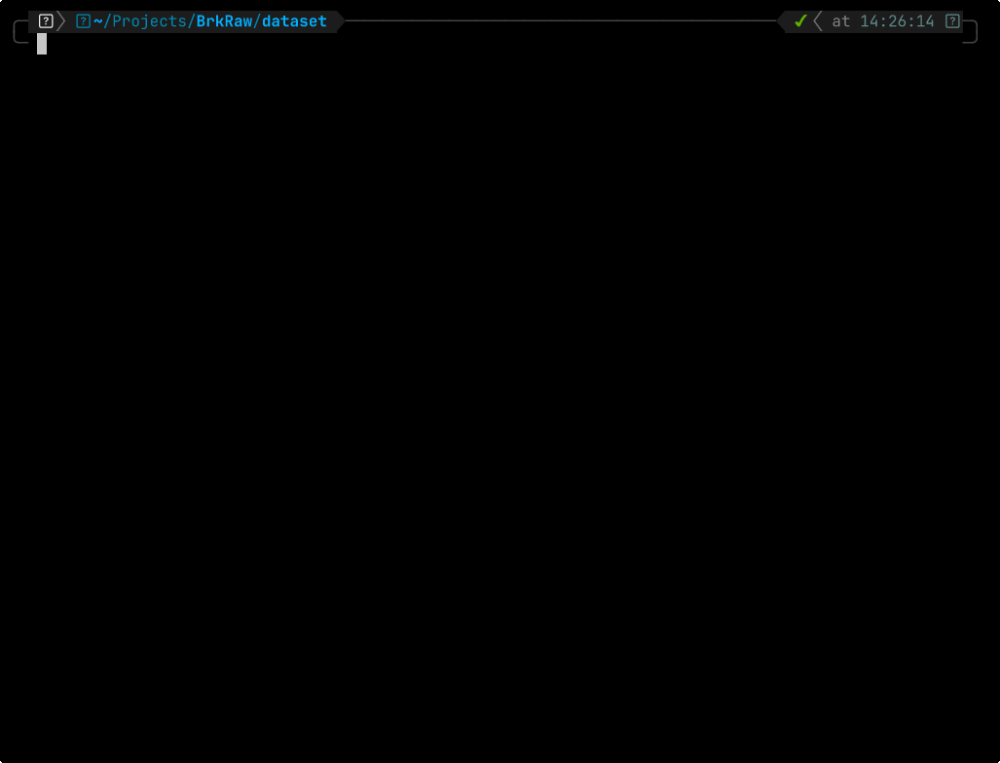

# BrkRaw

brkraw reads Bruker ParaVision MRI data and converts it to NIfTI with JSON
sidecars, in the folder layout you choose (including BIDS-style names).

```bash
brkraw info /path/to/study                           # what is in the study
brkraw convert /path/to/study -o out/ -c             # NIfTI files and sidecars
brkraw prune /path/to/study --anonymize -o share.zip # a copy for sharing
```



## How brkraw works

- Inspect first: study and scan information can be read from the CLI before
  converting.
- Parameter-based: rules and specs define what is read from the ParaVision
  parameter files and written to sidecars.
- Per-dataset choices: a context map next to a dataset sets output names and
  sidecar fields without changing the original information.
- Extensible: hook packages add sequence-specific conversion and
  reconstruction.

!!! note "Version 0.6"
    This documentation describes brkraw 0.6 (current pre-release: 0.6.1rc2).
    Moving from 0.5.x? See
    [Migrating to 0.6](getting-started/migrating.md).

## Start here

[Getting started](getting-started/index.md)
